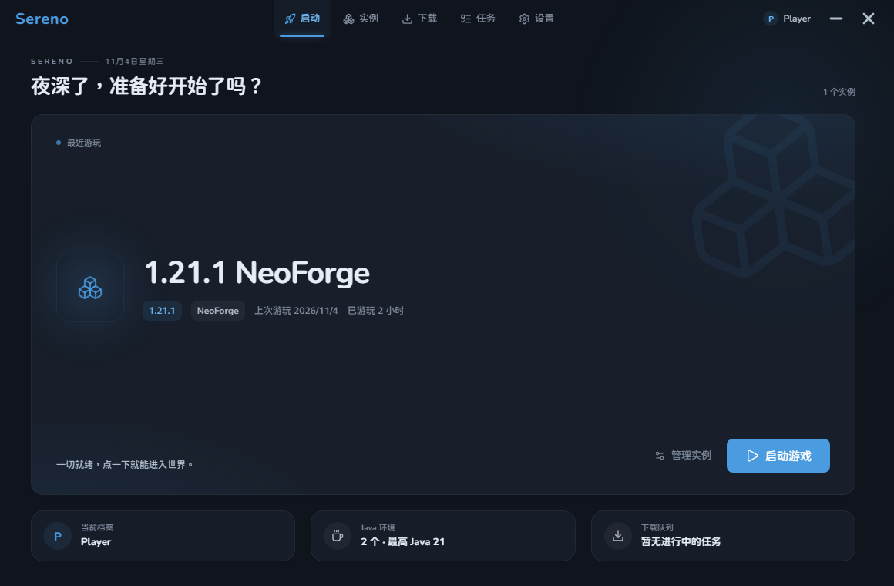

# Sereno

> [!WARNING]
> **本项目仅供个人学习、研究与非商业交流使用，严禁任何形式的商业售卖、套壳私服盈利、植入广告或捆绑商业插件。**
> Sereno 是一款完全免费、无广告、无遥测、不联机验证的单机启动器。
> 欢迎随意参考与借鉴本项目的代码与架构设计；若能注明「参考自 Sereno」，不胜感激。


A quiet, minimalist Minecraft launcher.

[Features](#features) · [Screenshots](#screenshots) · [Status](#status) · [License](#license) · [中文说明](#中文说明)

## Features

- Install and launch Vanilla, Fabric, Quilt, Forge, NeoForge, and OptiFine.
- Microsoft OAuth 2.0 login (Device Code Flow) and offline accounts; tokens are stored in the system keychain.
  **Note:** Microsoft login needs your own Azure app registration — see [Enabling Microsoft login](#enabling-microsoft-login).
- Third-party login via authlib-injective / Yggdrasil (LittleSkin, Ely.by, and any compatible server).
- Search and download mods, modpacks, resource packs, and shaders from Modrinth and CurseForge.
- **Install CurseForge modpacks** — `manifest.json` is resolved through the CF API, with per-file SHA-1 verification.
- **Import existing instances** from PCL, HMCL, MultiMC, Prism, or the official launcher — mods, configs and saves come along.
- Instance health checks: Java, memory, disk space, file integrity, mod dependencies, and recent crash diagnostics.
- World backups, log viewer, crash diagnostics, and diagnostic package export.
- Download speed limiting, mirror preference, resumable downloads, and incremental verification.
- **In-app updates** — the installer is checked against the published `SHA256SUMS.txt` before it is ever executed.

## Screenshots



The last-played instance takes the stage — one click to launch.  
最近游玩的实例会被放到舞台中央，点一下就能进入游戏。

## Status

`0.1.0`, still under active development. No installer released yet.

## Enabling Microsoft login

Offline accounts work out of the box. Microsoft login does **not** ship with a
client ID — using someone else's Azure application would route your Minecraft
account through a third party's redirect URI. Register your own free Azure app
and point Sereno at it:

1. Azure Portal → **App registrations** → **New registration**
2. Name it anything; set **Supported account types** to *Personal Microsoft accounts*
3. Add a **Web** redirect URI: `https://login.live.com/oauth20_desktop.srf`
4. Copy the **Application (client) ID**
5. Start Sereno with that value:

```
set SERENO_MS_CLIENT_ID=<your-client-id>
sereno.exe
```

Until then the launcher says "login is not configured yet" up front, instead of
failing halfway through the sign-in flow.

## License

**PolyForm Noncommercial License 1.0.0** — free to study, modify and use for any non-commercial
purpose; **commercial use of any kind is not permitted**. See [LICENSE](LICENSE).

> If you redistribute any part of this project, you must keep the license text (or its URL)
> included, and you may not sell, bundle or monetize it in any way.
> A copy published from an unofficial channel with ads or paid features attached is a violation
> of these terms, not a "fork".

Sereno is free, ad-free, telemetry-free and never phones home. It is not affiliated with
Mojang Studios, Microsoft or NetEase.

---

## 中文说明

一个安静、克制的 Minecraft 启动器。

Sereno 只做启动器该做的事：把游戏装好、把 Mod 管好、出问题时告诉你哪里坏了。界面尽量少放东西，能用一步完成的就不放两步。

### 目前能做的

- 原版游戏与 Fabric / Quilt / Forge / NeoForge / OptiFine 安装、启动
- 微软正版登录与离线账户，令牌保存在系统凭据管理器
  **注意：微软正版登录需要你自行在 Azure 注册应用**，见 [启用微软正版登录](#启用微软正版登录)
- 第三方登录（authlib-injective / Yggdrasil）：支持 LittleSkin、Ely.by 等兼容的皮肤站
- Mod、整合包、资源包、光影的搜索与下载，聚合 Modrinth 与 CurseForge
- **CurseForge 整合包安装**：解析 `manifest.json`，逐文件校验 SHA-1
- **从其它启动器导入实例**：认得 PCL / HMCL / MultiMC / Prism 的目录结构，
  把 Mod、配置与存档一并搬过来
- 实例健康检查：Java、内存、磁盘、文件完整性、Mod 依赖与最近崩溃一次说清
- 世界备份、日志查看、崩溃自动诊断与诊断包导出
- 下载限速、镜像优先、断点续传与增量校验
- **启动器自身的更新**：安装包要与随包发布的 `SHA256SUMS.txt` 对得上才允许执行

### 当前状态

`0.1.0`，仍在持续开发中，暂未发布安装包。

遇到问题或有功能建议，欢迎在 [Issues](https://github.com/zuoqiuning/Sereno/issues) 里提出。

## 启用微软正版登录

离线档案开箱即用；**微软正版登录不随包附带客户端 ID**——用别人的 Azure 应用等于
把你的 Minecraft 账号经由第三方回调地址走一遍。请自行注册一个免费应用：

1. Azure 门户 → **应用注册** → **新注册**
2. 名称随意；**支持的账户类型**选「个人 Microsoft 账户」
3. 添加 **Web** 重定向 URI：`https://login.live.com/oauth20_desktop.srf`
4. 复制**应用程序（客户端）ID**
5. 用该值启动 Sereno：

```
set SERENO_MS_CLIENT_ID=<你的客户端 ID>
sereno.exe
```

未配置时，界面会明确提示「登录尚未开放」，而不是在登录流程中途失败。

## 支持作者

如果 Sereno 帮你省下了一点折腾的时间，欢迎请我喝杯奶茶。  
赞助不会解锁任何额外功能，只是让我更有底气把它一直维护下去。

爱发电主页：https://ifdian.net/a/Sereno

## 开源协议与致谢 / License & Acknowledgements

本项目基于 **[PolyForm Noncommercial License 1.0.0](LICENSE)** 开源：你可以自由地学习、修改，
并在**任何非商业目的**下使用与分发；但**严禁任何形式的商业使用**——包括但不限于套壳售卖、
绑定私服充值、投放商业广告、捆绑付费插件。

如果你借鉴了这里的代码或机制，希望能在你的项目中注明「某某功能参考自 `https://github.com/zuoqiuning/Sereno`」。
这不是硬性规定，但对我来说会是很大的鼓励和认可！

Sereno 本身完全免费、无广告、无遥测、不联机验证，也不会因为你没登录任何账号而影响使用。
本软件与 Mojang Studios、Microsoft、网易公司无关。

This project is open-source under the [PolyForm Noncommercial License 1.0.0](LICENSE): study it, modify it,
and use it for any non-commercial purpose — but **commercial use of any kind is not permitted**
(including selling a repackaged build, monetized private servers, ads, or bundled paid plugins).

If you find Sereno's code or mechanisms helpful and use them in your project, we would really appreciate it
if you could mention "Feature X inspired by `https://github.com/zuoqiuning/Sereno`" in your documentation.
This is completely optional and not a legal requirement, but it means a lot to us. Thanks!

---

Made by 丘屿知宁
