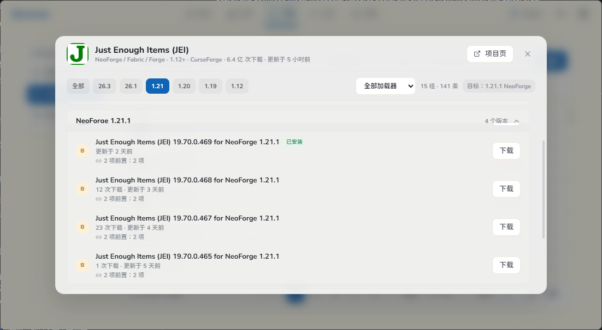

# Sereno

A quiet, minimalist Minecraft launcher.

[Features](#features) · [Screenshots](#screenshots) · [Status](#status) · [License](#license) · [中文说明](#中文说明)

## Features

- Install and launch Vanilla, Fabric, Quilt, Forge, and NeoForge.
- Microsoft OAuth 2.0 login (Device Code Flow) and offline accounts; tokens are stored in the system keychain.
- Search and download mods, modpacks, resource packs, and shaders from Modrinth and CurseForge.
- Instance health checks: Java, memory, disk space, file integrity, mod dependencies, and recent crash diagnostics.
- World backups, log viewer, crash diagnostics, and diagnostic package export.
- Download speed limiting, mirror preference, resumable downloads, and incremental verification.

## Screenshots

Version groups, filters and one-click download in a single panel.

## Status

`0.1.0`, still under active development. No installer released yet.

## License

MIT — free to use and modify. See [LICENSE](LICENSE).

---

## 中文说明

一个安静、克制的 Minecraft 启动器。

Sereno 只做启动器该做的事：把游戏装好、把 Mod 管好、出问题时告诉你哪里坏了。界面尽量少放东西，能用一步完成的就不放两步。

### 目前能做的

- 原版游戏与 Fabric / Quilt / Forge / NeoForge 安装、启动
- 微软正版登录与离线账户，令牌保存在系统凭据管理器
- Mod、整合包、资源包、光影的搜索与下载，聚合 Modrinth 与 CurseForge
- 实例健康检查：Java、内存、磁盘、文件完整性、Mod 依赖与最近崩溃一次说清
- 世界备份、日志查看、崩溃自动诊断与诊断包导出
- 下载限速、镜像优先、断点续传与增量校验

### 当前状态

`0.1.0`，仍在持续开发中，暂未发布安装包。

遇到问题或有功能建议，欢迎在 [Issues](https://github.com/zuoqiuning/Sereno/issues) 里提出。

## 支持作者

如果 Sereno 帮你省下了一点折腾的时间，欢迎请我喝杯奶茶。  
赞助不会解锁任何额外功能，只是让我更有底气把它一直维护下去。

爱发电主页：https://ifdian.net/a/Sereno

## 开源协议与致谢 / License & Acknowledgements

本项目基于 [MIT 协议](LICENSE) 开源，你可以自由使用和修改。如果你借鉴了这里的代码或机制，希望能在你的项目中注明「某某功能参考自 `https://github.com/zuoqiuning/Sereno`」。这不是硬性规定，但对我来说会是很大的鼓励和认可！

This project is open-source under the [MIT License](LICENSE). You are free to use and modify the code. If you find Sereno's code or mechanisms helpful and use them in your project, we would really appreciate it if you could mention "Feature X inspired by `https://github.com/zuoqiuning/Sereno`" in your documentation. This is completely optional and not a legal requirement, but it means a lot to us. Thanks!

---

Made by 丘屿知宁
